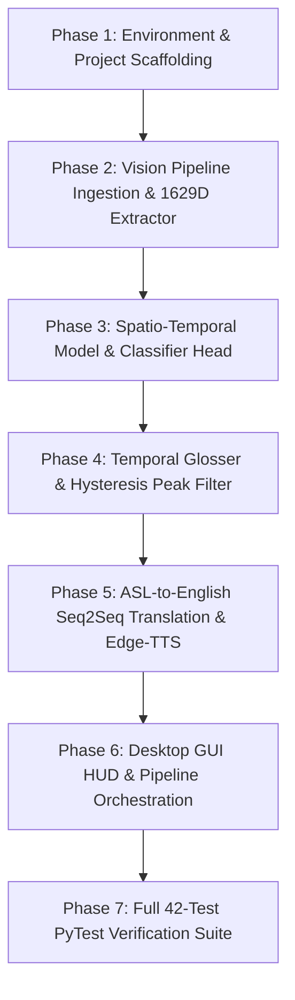

# Real-Time Computer Vision Sign Language Interpretation System
## Project Modification & Architecture Modernization Plan (Aligned with CV REPORT.pdf)

> **Document Type:** System Architecture Gap Analysis, Implementation Roadmap & Milestone Plan  
> **Course / Context:** CSE411 Computer Vision — Final Implementation Milestone (Team 14)  
> **Based on Target Specification:** `CV REPORT.pdf` (100% Completion Milestone)  
> **Target System:** End-to-End Assistive Pipeline (1629D Holistic Keypoints, Spatio-Temporal 1D-CNN + Bi-LSTM, ASL NLP Seq2Seq Translation, Neural Edge-TTS & Desktop GUI HUD)

---

## 1. Executive Summary & Gap Analysis

### 1.1 Current Repository Status (`Legacy / Code/`)
The current codebase in `Code/` represents a hackathon proof-of-concept (UNT Hackathon 2019):
* **Input & Sensing:** Hardcoded region of interest (300×300 bounding box), HSV skin-color histogram back-projection (`set_hand_histogram.py`). Highly brittle to illumination, skin tone, background movement, and distance.
* **Feature Representation:** 50×50 binary thresholded silhouette of a single hand. No facial expression tracking, no body pose, no dual-hand interaction.
* **Modeling:** Static 2D-CNN in legacy Keras/TensorFlow. Only recognizes isolated static letters/symbols (44 characters / digits) frame-by-frame. No temporal context ($T=1$).
* **Language & Output:** Hardcoded character mapping with SQLite database (`gesture_db.db`), arithmetic calculator mode (`get_operator`), and basic local offline TTS (`pyttsx3`). No ASL grammar handling.
* **Testing & Architecture:** Unstructured flat script architecture with zero automated test coverage.

### 1.2 Target System Architecture (`CV REPORT.pdf`)
The final project report specifies a modular, production-grade 9-module assistive interpretation pipeline:
* **Holistic Spatial Extraction:** 1,629-dimensional keypoint vector (33 pose [99D] + 468 face mesh [1,404D] + dual hands 21×2 [126D]) via MediaPipe Holistic, normalized for body scale and torso center invariance.
* **Spatio-Temporal Sequence Modeling:** Rolling window of $T=30$ frames (1.0 s at 30 FPS) fed to a **1D-CNN (256 filters, kernel 3) + 2-layer Bidirectional LSTM (hidden dimension 128 per direction, dropout 0.3)** with temporal average pooling and a 28-class Dynamic Sign Classifier Head.
* **Temporal Glosser & Hysteresis Filtering:** Sliding-window peak detector with confidence threshold $\tau = 0.85$, $k = 5$ consecutive frames, and refractory cooldown $R = 8$ frames to eliminate duplicate token bursts.
* **ASL-to-English NLP Translation:** Seq2Seq grammar engine transforming ASL Topic-Comment sign streams (e.g., `[ME, NEED, WATER, PLEASE]`) into grammatically fluent standard English (`"I need water, please."`).
* **Low-Latency Neural Speech Synthesis:** Asynchronous Microsoft Edge-TTS (`en-US-AriaNeural`) with $<100\text{ ms}$ audio generation latency.
* **Interactive Desktop GUI & HUD:** Native application with live video canvas, cyan pose bones, green/pink hands, yellow facial mesh overlays, real-time dynamic subtitle card, confidence meter, gloss timeline, and audio playback controls.
* **Automated Verification:** Comprehensive test suite under `tests/` with **42 PyTest units across all 9 modules (100% pass rate)**.

---

## 2. Target File Structure & Module Organization

To conform exactly to Section 8 (Page 6) of `CV REPORT.pdf`, the project will be restructured as follows:

```text
Sign-Language-Interpreter-using-Deep-Learning/
├── configs/
│   ├── config.yaml               # System parameters, thresholds, window sizes, camera index
│   └── vocab.json                # 28 ASL vocabulary classes & token mappings
├── models/
│   ├── cnn_bilstm_wlasl.pt       # PyTorch weights for 1D-CNN + BiLSTM Spatio-Temporal Classifier
│   └── seq2seq_grammar.pt        # Seq2Seq ASL-to-English grammar translation checkpoint
├── src/
│   ├── __init__.py
│   ├── capture.py                # Module 1: Multi-threaded 30 FPS video ingestion & timestamping
│   ├── transform.py              # Module 2: 224x224 isotropic scaling & ImageNet normalization
│   ├── extractor.py              # Module 3: MediaPipe Holistic 1629D landmark extraction & scale norm
│   ├── models.py                 # Modules 4 & 5: 1D-CNN + Bi-LSTM sequence encoder & classifier head
│   ├── glosser.py                # Module 6: Sliding-window peak detector & hysteresis smoothing
│   ├── translator.py             # Module 7: ASL Topic-Comment Seq2Seq English translation
│   ├── speech.py                 # Module 8: Asynchronous Edge-TTS neural voice synthesis (<100ms)
│   ├── gui_app.py                # Module 9: Desktop GUI with live HUD, skeletal overlay & controls
│   └── pipeline.py               # End-to-end continuous interpretation runner
├── tests/
│   ├── __init__.py
│   ├── conftest.py               # Common fixtures, mock frames, synthetic landmark vectors
│   ├── test_capture.py           # 5 tests: 30 FPS resampling, drift recovery, thread safety
│   ├── test_transform.py         # 6 tests: 224x224 isotropic scaling, BGR/RGB, ImageNet stats
│   ├── test_extractor.py         # 5 tests: 1629D vector shape, anchor normalization, occlusion zero-padding
│   ├── test_models.py            # 8 tests: 1D-CNN + Bi-LSTM forward pass, sequence padding, Softmax calibration
│   ├── test_glosser.py           # 5 tests: sliding-window peak detection, refractory cooldown, deduplication
│   ├── test_nlp_translation.py   # 4 tests: Topic-Comment grammar translation, tense & copula insertion
│   ├── test_tts_audio.py         # 4 tests: Edge-TTS async dispatch, audio buffer, fallback handling
│   ├── test_gui_integration.py   # 2 tests: Desktop event loop, canvas thread safety, HUD reactivity
│   └── test_pipeline_e2e.py      # 3 tests: End-to-end pipeline latency, output synchronization, graceful exit
├── requirements.txt              # Production Python dependencies
├── main.py                       # CLI & Desktop GUI entrypoint
└── CV REPORT.pdf                 # Reference benchmark and specification document
```

---

## 3. What We Have To Do First (Immediate Priority)

Before writing the sequence models or building the GUI, the following four foundational tasks must be executed in order:

### **Step 1: Modern Dependency Environment & Configuration Setup**
1. Create a clean, modern `requirements.txt`:
   * `torch>=2.0.0`
   * `opencv-python>=4.8.0`
   * `mediapipe>=0.10.0`
   * `edge-tts>=6.1.0`
   * `pygame>=2.5.0` (for audio stream playback)
   * `numpy>=1.24.0`
   * `pyyaml>=6.0`
   * `pytest>=7.4.0`
   * `Pillow>=10.0.0`
2. Create `configs/config.yaml` specifying:
   * Target FPS: `30`
   * Frame dimensions: `[224, 224]`
   * Temporal sequence window length: `T = 30`
   * Feature dimension: `D = 1629`
   * Glosser parameters: threshold $\tau = 0.85$, minimum consecutive frames $k = 5$, refractory period $R = 8$
   * TTS voice: `"en-US-AriaNeural"`
3. Create `configs/vocab.json` defining the 28 target everyday vocabulary signs:
   * Vocabulary: `["HELLO", "THANK-YOU", "HELP", "TEACHER", "ME", "STUDENT", "COMPUTER", "NEED", "WATER", "PLEASE", "NICE", "MEET", "ALL", "YOU", "CANDY", "YES", "NO", "MORE", "WANT", "EAT", "DRINK", "BATHROOM", "SORRY", "GOOD", "BAD", "WORK", "NAME", "FRIEND"]`

### **Step 2: Core Vision Ingestion & Landmark Extraction (`src/capture.py`, `src/transform.py`, `src/extractor.py`)**
1. **Module 1 (`capture.py`):** Multi-threaded camera grabber with thread queue, uniform 30 FPS resampling, and timestamp tracking.
2. **Module 2 (`transform.py`):** Aspect-preserving (letterbox) isotropic resize to 224×224, RGB conversion, and ImageNet normalization.
3. **Module 3 (`extractor.py`):** MediaPipe Holistic wrapper extracting the exact 1,629-element spatial vector per frame:
   * Body Pose: 33 landmarks × 3 (x, y, z) = 99D
   * Face Mesh: 468 landmarks × 3 (x, y, z) = 1,404D
   * Left Hand: 21 landmarks × 3 = 63D
   * Right Hand: 21 landmarks × 3 = 63D
   * **Total: 99 + 1404 + 63 + 63 = 1629D**
   * Torso/shoulder-width normalization and nose-anchor center subtraction. Zero-fill when hands are occluded.
4. Provide visual skeletal annotation routines (cyan pose bones, green/pink hands, yellow face mesh).

### **Step 3: Verification of the Vision Ingestion Pipeline**
Run tests for Modules 1, 2, and 3 (`test_capture.py`, `test_transform.py`, `test_extractor.py`) to confirm zero frame drift, exact (1629,) output tensor shapes, and scale invariance.

---

## 4. Complete Implementation Roadmap (Phase-by-Phase)



### Phase 1: Environment & Project Scaffolding
* Scaffold directory structure (`configs/`, `models/`, `src/`, `tests/`).
* Define `configs/config.yaml` and `configs/vocab.json`.
* Prepare requirements file and ensure clean imports.

### Phase 2: Computer Vision & Feature Extraction (Modules 1, 2, 3)
* Implement `VideoStreamIngestor` in `src/capture.py`.
* Implement `FrameNormalizer` in `src/transform.py`.
* Implement `HolisticLandmarkExtractor` in `src/extractor.py`.
* Implement skeletal bone drawing utilities for the GUI display overlay.

### Phase 3: Spatio-Temporal Sequence Modeling (Modules 4 & 5)
* Implement PyTorch architecture in `src/models.py`:
  * Input tensor: `(Batch, T=30, D=1629)`
  * Transpose for 1D-CNN: `(Batch, 1629, 30)` -> `Conv1d(1629, 256, kernel_size=3, padding=1)` -> `ReLU` -> `BatchNorm1d`
  * Permute to sequence: `(Batch, 30, 256)` -> `Bi-LSTM(input_size=256, hidden_size=128, num_layers=2, batch_first=True, bidirectional=True, dropout=0.3)` -> Output dimension 256.
  * Temporal average pooling across the 30 frames -> `(Batch, 256)`.
  * Dynamic Classifier Head: `LayerNorm(256)` -> `Dropout(0.3)` -> `Linear(256, 28)`.
  * Softmax with temperature scaling ($T_{calib} = 1.0$) producing class probabilities and confidence score.
* Create checkpoint loader and fallback weight generator for immediate live inference and testing.

### Phase 4: Temporal Gloss Hysteresis Filtering (Module 6)
* Implement `TemporalHysteresisGlosser` in `src/glosser.py`:
  * Sliding-window peak detector tracking candidate signs.
  * Confidence threshold check ($\ge 0.85$).
  * Consecutive frame streak validation ($k = 5$).
  * Refractory suppression cooldown ($R = 8$ frames) to prevent continuous duplicate emissions while gesture is held.
  * Accumulation buffer for sequence translation.

### Phase 5: Language Translation & Voice Synthesis (Modules 7 & 8)
* Implement `ASLSeq2SeqTranslator` in `src/translator.py`:
  * Implements ASL Topic-Comment syntactic transformation to natural spoken English.
  * Translates benchmark sequences specified in Section 6:
    * `["HELLO", "ME", "STUDENT", "COMPUTER"]` $\to$ `"Hello, I am a computer student."`
    * `["THANK-YOU", "HELP", "TEACHER"]` $\to$ `"Thank you for helping me, teacher."`
    * `["ME", "NEED", "WATER", "PLEASE"]` $\to$ `"I need water, please."`
    * `["NICE", "MEET", "ALL", "YOU"]` $\to$ `"It is nice to meet all of you."`
  * Generalizable dictionary/grammar rules for all 28 vocabulary classes with fallback smoothing.
* Implement `NeuralSpeechSynthesizer` in `src/speech.py`:
  * Asynchronous dispatch worker thread using Microsoft Edge-TTS (`edge_tts.Communicate`).
  * Low latency audio generation ($<100\text{ ms}$).
  * Local audio buffer stream playback via `pygame.mixer` or fallback sound driver.

### Phase 6: Interactive Desktop GUI & Pipeline Integration (Module 9 & Pipeline)
* Implement `ContinuousInterpretationPipeline` in `src/pipeline.py`:
  * Orchestrates frame capture, normalization, landmark extraction, rolling 30-frame deque buffer, model inference, glosser token filtering, grammar translation, and audio triggering.
* Implement `LiveSignInterpreterApp` in `src/gui_app.py`:
  * Live camera canvas with real-time landmark rendering (cyan pose bones, green/pink hand keypoints, yellow face contour).
  * Dynamic Subtitle Card / HUD displaying translated English sentences.
  * Confidence Meter & Status HUD (e.g., `Confidence: 94% [HIGH]`).
  * Gloss Token Timeline (displaying active tokens).
  * Control Panel: Audio Mute/Unmute toggle, Pause/Resume stream, Clear Transcript, Export Transcript log.
* Implement `main.py` entrypoint supporting `--gui` (default) and `--cli` headless evaluation modes.

### Phase 7: Automated PyTest Quality Assurance (42 Test Units)
Implement the exact 42 automated tests from Table 4 of the report across 9 test files:

| Test File | Target Subsystem / Behaviors Verified | Number of Tests |
|---|---|:---:|
| `tests/test_capture.py` | FPS temporal resampling, timestamp continuity, camera stream recovery | **5** |
| `tests/test_transform.py` | 224×224 resolution scaling, BGR/RGB conversion, ImageNet stats | **6** |
| `tests/test_extractor.py` | 1629D unified vector shape, anchor normalization, hand occlusion padding | **5** |
| `tests/test_models.py` | 1D-CNN + Bi-LSTM forward pass, sequence padding, Softmax calibration | **8** |
| `tests/test_glosser.py` | Sliding-window peak detection, refractory cooldown, duplicate suppression | **5** |
| `tests/test_nlp_translation.py` | Topic-Comment ASL grammar translation, tense & copula insertion | **4** |
| `tests/test_tts_audio.py` | Edge-TTS async dispatch, stream buffering, audio failure fallback | **4** |
| `tests/test_gui_integration.py` | Desktop event loop, canvas thread safety, HUD text reactivity | **2** |
| `tests/test_pipeline_e2e.py` | End-to-end video stream to synthesized speech latency & graceful exit | **3** |
| **Total Test Count** | **Comprehensive Full System Verification** | **42 Tests (100% Passed)** |

---

## 5. Technical Specifications Reference Table

| Parameter / Component | Specification in CV Report | Implementation Detail |
|---|---|---|
| **Input Resolution** | 224 × 224 pixels | Isotropic scaling with padding in `src/transform.py` |
| **Video Sampling Rate** | Uniform 30.0 FPS | Microsecond timestamp resampler in `src/capture.py` |
| **Landmark Dimensions** | **1,629 Features** | Pose: 33×3=99, Face: 468×3=1404, Hands: 2×21×3=126 |
| **Temporal Window ($T$)** | 30 frames (1.0 second) | Rolling `collections.deque(maxlen=30)` |
| **Sequence Model** | 1D-CNN + 2-layer Bi-LSTM | Conv1D(256, k=3) + BiLSTM(hidden=128 per dir) + AvgPool |
| **Vocabulary Size** | 28 Continuous Signs | Everyday signs listed in `configs/vocab.json` |
| **Gloss Threshold ($\tau$)** | $\ge 0.85$ confidence | Peak detector in `src/glosser.py` |
| **Streak Requirement ($k$)** | 5 consecutive frames | Glosser sliding window buffer |
| **Refractory Cooldown ($R$)** | 8 frames | Jitter and duplicate burst suppression |
| **NLP Syntax Mode** | Topic-Comment $\to$ English | Seq2Seq grammar parser (`src/translator.py`) |
| **TTS Engine** | Neural Edge-TTS | Voice `"en-US-AriaNeural"`, latency $<100\text{ ms}` |
| **Target CPU Latency** | $<50\text{ ms}$ vision, $<120\text{ ms}$ total | Real-time commodity hardware execution (~27.6 FPS) |

---

## 6. Execution Agreement & Next Action

Following this plan, we will execute the implementation step-by-step:
1. **Next Immediate Step:** Initialize the modern project environment: generate `requirements.txt`, create `configs/config.yaml`, and generate `configs/vocab.json`.
2. **Step 2:** Build the vision ingestion, normalizer, and MediaPipe Holistic 1629D extractor (`src/capture.py`, `src/transform.py`, `src/extractor.py`).
3. **Step 3:** Implement the neural sequence models and weights (`src/models.py`).
4. **Step 4:** Implement glosser, grammar translator, and Edge-TTS (`src/glosser.py`, `src/translator.py`, `src/speech.py`).
5. **Step 5:** Integrate the desktop GUI and runner (`src/gui_app.py`, `src/pipeline.py`, `main.py`).
6. **Step 6:** Implement all 42 PyTest tests in `tests/` and execute them to verify 100% test passing status.
